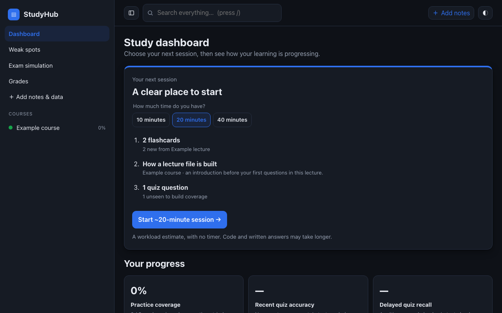
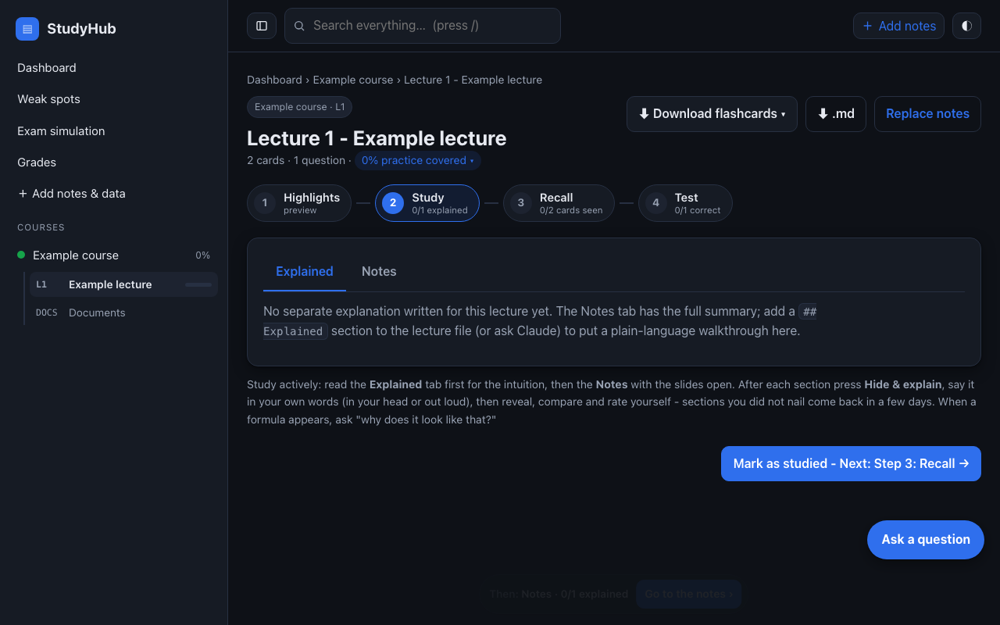

<div align="center">

# StudyHub

**A local-first study app for exams: notes, flashcards, spaced repetition, exam-style quizzes and an exam plan that tells you what to learn next.**




</div>

---

## Why StudyHub

Built for short, frequent study sessions (5 to 15 minutes) before an exam: open it, tap one button, answer questions, see what to do next. Your notes are plain Markdown files, your progress stays on your machine, and nothing is sent to a server.

## Features

| | |
|---|---|
| **Guided lecture flow** | Highlights → Study → Recall → Test for every lecture, with a floating "next step" bar. |
| **Hide & explain** | Cover a notes section, explain it in your own words, reveal, rate yourself. Sections you did not nail come back later. |
| **Spaced repetition** | Flashcards and quiz questions return when due. Wrong answers come back sooner. |
| **Rich quizzes** | Multiple choice, select-all, true/false, numeric (with tolerance), short answer with a self-grading rubric, runnable code questions, and **randomised calculation problems** with new numbers each time. |
| **Learn from mistakes** | A short explanation after every answer, a link to the notes section it belongs to, and **"Test this idea again"**, which adds a related question or a fresh variant next. |
| **Exam plan** | Ranks topics by documented exam history, how much you have *not* mastered, how many topics build on them and the time they take. Documented and estimated evidence are labelled. |
| **Exam simulation** | Timed, no feedback until you submit, self-graded written answers, per-theme results. An **exam paper** mode builds a paper with one multi-part question per exam theme. A practice score, never a grade prediction. |
| **Honest progress** | Separates *solid* mastery (confirmed over time) from *recent* correct answers, plus coverage, accuracy and delayed recall. |
| **Slides next to notes** | Put lecture PDFs in `slides/` and each notes block gets a "slide N" link; slides are searchable. |
| **Multiple courses** | One app, many subjects. The engine is separate from your content. |
| **Private and portable** | Progress is saved to a JSON file (iCloud Drive or `~/StudyHub-progress/`) with hourly backups. A one-file standalone build works without Python. |

<div align="center">

</div>

## Quick start

```bash
git clone https://github.com/sondreNodenes/studyhub.git
cd studyhub
python3 serve.py            # open http://localhost:8000
```

On macOS you can also double-click `Start StudyHub.command`. Keep using the same address so your browser data stays attached. `serve.py` also saves progress to a file, so clearing the browser does not lose it.

The repo ships with a tiny example course. To study your own subjects, point the engine at a content folder (below).

## Your own courses

A *content folder* holds your courses and is independent of the engine, so you can keep it private and still share the engine.

```
my-courses/
├── content/
│   └── <course-id>/
│       ├── course.md          # name, id, colour, "how the professor tests"
│       ├── 01-topic.md        # one file per lecture
│       └── img/               # figures (svg / png)
├── slides/                    # lecture PDFs (optional)
└── materials/                 # anything else you want served (optional)
```

```bash
python3 build.py --content ~/my-courses     # writes data.js + StudyHub-standalone.html
python3 serve.py --content ~/my-courses     # or: export STUDYHUB_CONTENT=~/my-courses
```

Files in the content folder win over the engine's, so `data.js`, `slides/` and `materials/` come from your courses while `index.html` comes from the engine. Copy `_engine.py` plus small `build.py` / `serve.py` wrappers into your content folder if you want to run the commands from there.

### Lecture file format

````markdown
# Lecture 7 - Intertemporal choice
code: L7
pdf: slides/Lec 07.pdf
weight: 3        # optional exam-plan data: past exam questions on this topic
tier: 1          # 1 critical, 2 important, 3 supplementary
needs: L2        # prerequisite lecture codes
minutes: 25      # estimated time to learn

## Highlights
- The key ideas, one bullet each.

## Summary
## First topic
**In plain words.** ...

## Flashcards
Q: What is the discounted utility of a stream?
A: U_0 = u_0 + δ u_1 + δ² u_2 + ...

## Quiz
? [mcq] Which option is correct?
- wrong
* right
> Why it is right.

? [calc] A stream pays 0, 5, 20 and δ = 0.8. What is U_0?
= 16.8 ±0.01
````

Question types: `mcq`, `multi`, `tf`, `calc`, `short`, `code` and `gen` (randomised, with `@ var = a,b,c` and a formula). In `course.md`, `examq:`, `exams:` and `blueprint:` enable the exam plan and exam papers. See `content/example-course/` for a working example.

Course pages for past exams can be added as worksheets with a code like `EX25`.

## Optional extras

- **Slide links and search:** `brew install poppler` (`pdftotext`).
- **Notebook slideshows to PDF:** `engine/nb2pdf.py` (needs Google Chrome).
- **Runnable Python questions:** run in the browser (Pyodide), nothing to install.
- **Claude Code skill:** `.claude/skills/lecture-notes` turns slides into a complete lecture file with notes, flashcards, a quiz and generated problems.

## Project layout

```
studyhub/
├── index.html            # the whole app (HTML, CSS, JS)
├── build.py              # bundles content/ into data.js and a standalone HTML file
├── serve.py              # local server + progress saving (localhost only)
├── _engine.py            # helper for running the engine from a content folder
├── engine/               # slide mapping, SVG maths, Python-in-browser runner
├── content/example-course/
└── .claude/skills/lecture-notes/
```

## Privacy and security

- Everything runs on your computer. No accounts, no analytics, no network calls except loading Pyodide when you run a code question.
- `serve.py` listens on `127.0.0.1` only, answers the sync endpoint only to localhost host names, limits request size and writes progress atomically.

## Status

Personal project, actively used. Issues and ideas are welcome.
